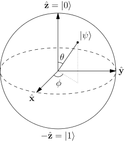

# Quantum States and Qubits

## Two-Level Quantum Systems

A quantum system is described by a set of allowed states belonging to a complex Hilbert space, which provides the mathematical framework for describing its physical state.

### Why a Two-Dimensional System?

The mathematical description of a physical quantum system can involve many degrees of freedom or observables but we can restrict attention to a smaller subspace depending upon the application.

A classical bit has two possible logical states, so we choose a two-dimensional quantum system as the basic unit of quantum information. When multiple qubits are combined, the dimension of the corresponding state space grows exponentially with the number of qubits.

### Realizing a Two-Level System

Quantum mechanically, an atom can have discrete energy eigenvalues $\{ E_n \}$. Suppose we select two energy levels $E_0$ and $E_1$. These can be used as the two computational states.

A transition between the two levels can be induced by interacting with the atom through an appropriate external field.

## Qubit Algebra

### General Qubit State

Using Dirac notation, a quantum state is represented by a ket $\ket{\psi}$.

For quantum computing, we consider a two-dimensional Hilbert space $\mathcal{H}$ and choose the orthonormal basis $\{ \ket{0}, \ket{1} \}$ which is referred to as the computational basis, and represent them by coordinates

$$
\ket{0} =
\begin{pmatrix}
1 \\
0
\end{pmatrix}
$$

and

$$
\ket{1} =
\begin{pmatrix}
0 \\
1
\end{pmatrix}
$$

Thus,

$$
\mathcal{H} = span\{\ket{0}, \ket{1} \}
$$

Any quantum state $\ket{\psi} \in \mathcal{H}$ is thus given by

$$
\ket{\psi} = \alpha \ket{0} + \beta \ket{1}
$$

where $\alpha, \beta \in \mathbb{C}$ are called _probability amplitudes_.

The state $\ket{\psi}$ is referred to a _superposition_ of the two basis states.

For a normalized state, using the orthonormality of the computational basis, we have

$$
\braket{\psi | \psi} = |\alpha|^2 + |\beta|^2 = 1
$$

### Measurement in the Computational Basis

When we measure in the computational basis, there are two possible outcomes, $0$ and $1$.

We use the two measurement operators

$$
M_0 = \ket{0}\bra{0}, \qquad M_1 = \ket{1}\bra{1}.
$$

Suppose the state is

$$
\ket{\psi} = \alpha\ket{0} + \beta\ket{1}.
$$

According to the measurement postulate, after incorporating Born's statistical interpretation, the probability of obtaining outcome $0$ is

$$
\begin{aligned}
p(0)
&= \bra{\psi}M_0^\dagger M_0\ket{\psi}\\
&= \bra{\psi}M_0\ket{\psi}\\
&= |\alpha|^2.
\end{aligned}
$$

Similarly,

$$
p(1)=\bra{\psi}M_1^\dagger M_1\ket{\psi}=|\beta|^2.
$$

Since the state is normalized,

$$
|\alpha|^2+|\beta|^2=1,
$$

and hence

$$
p(0)+p(1)=1.
$$

If the measurement outcome is $0$, the post-measurement state is $\ket{0}$, while if the outcome is $1$, the post-measurement state is $\ket{1}$.

In the convention used here, $\ket{0}$ denotes the excited state.

### Superposition versus Mixture

A mixture means that each individual system is in one definite state, but it is not known which one. For example, the system is in $\ket{0}$ with probability $p$ and in $\ket{1}$ with probability $1-p$.

A superposition, on the other hand, is a single quantum state

$$
\ket{\psi} = \alpha\ket{0} + \beta\ket{1}.
$$

The amplitudes $\alpha,\beta\in\mathbb{C}$ contain both magnitude and phase. Their magnitudes determine the probabilities of obtaining the corresponding computational-basis outcomes upon measurement, while their physically relevant relative phase can affect the outcomes of subsequent measurements.

## Bloch Sphere Representation

We know that a state of the qubit can be represented by

$$
\ket{\psi} = \alpha \ket{0} + \beta \ket{1}
$$

Now, since $\alpha$ and $\beta$ are complex numbers, we can represent

$$
\alpha = |\alpha| e^{i \theta_{\alpha}}
$$

and

$$
\beta = |\beta| e^{i \theta_{\beta}}
$$

Also, we know by normalization,

$$
|\alpha|^2 + |\beta|^2 = 1
$$

so we can choose a $\theta$ such that $|\alpha| = \cos (\theta/2)$ and $|\beta| = \sin (\theta/2)$ and $0 \leq \theta \leq \pi$. So, we have

$$
\ket{\psi} =  e^{i \theta_{\alpha}} \cos (\frac{\theta}{2})  \ket{0} + e^{i \theta_{\beta}} \sin (\frac{\theta}{2}) \ket{1}
$$

Now, we can factor out the term $e^{i \theta_{\alpha}}$, we get

$$
\ket{\psi} =  e^{i \theta_{\alpha}}  \left( \cos (\frac{\theta}{2}) \ket{0} +  e^{i (\theta_{\beta} - \theta_{\alpha})} \sin (\frac{\theta}{2})  \ket{1} \right)
$$

Let the relative phase be defined as $\phi = \left(\theta_{\beta} - \theta_{\alpha} \right) \mod 2\pi$ such that $0 \leq \phi \lt 2\pi$ and ignoring the phase factor of $e^{i \theta_{\alpha}}$ , since a global phase has no physical significance and does not affect measurement probabilities, we obtain

$$
\boxed{\ket{\psi} =  \cos (\frac{\theta}{2})\ket{0} +  e^{i \phi} \sin(\frac{\theta}{2}) \ket{1}}
$$

which is hence essentially determined by two real parameters, $\phi$ and $\theta$ and thus

$$
\ket{\psi} \equiv \ket{\theta, \phi}
$$

This can be equivalently represented by a point on the sphere of unit radius represented in vector form $\vec{n}$ with respect to origin which is given by

$$
\vec{n} = \sin \theta \cos \phi \vec{e_x} + \sin \theta \sin \phi \vec{e_y} + \cos \theta \vec{e_z}
$$

where $\vec{e_x}, \vec{e_y}, \vec{e_z}$ are the vectors representing $x$, $y$ and $z$ axes respectively whereas $\theta$ is the angle from the $z$-axis, called polar angle and $\phi$ is the rotation in the $xy$-plane from the $x$-axis, called azimuthal angle.

Hence, every pure qubit state has an equivalent representation by a point on a sphere of unit radius. We call this sphere the Bloch sphere.

Also, note that for $\theta = 0$, we have

$$
\ket{\psi} = \ket{0, \phi} = \ket{0}
$$

and

$$
\vec{n_0} = \vec{e_z}
$$

and similarly for $\theta = \pi$, we have

$$
\ket{\psi} = \ket{\pi, \phi} = \ket{1}
$$

and

$$
\vec{n_{\pi}} = - \vec{e_z}
$$

Thus, $\ket{0}$ represents the North Pole in the Bloch Sphere whereas $\ket{1}$ represents the South Pole.
