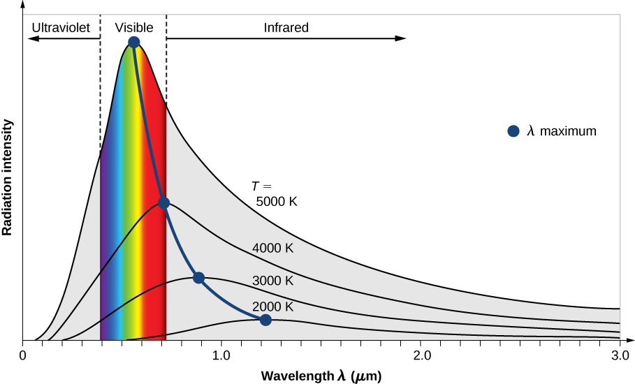

## Failures of Classical Theory

### 1. Blackbody Radiation

A blackbody is an ideal object that absorbs all electromagnetic radiation falling on it and emits radiation on heating. 

Experimentally, the spectrum looks like this

The findings can be summarized by 
1. **Wien's Displacement Law** 
	$\lambda_{max} T = 2.898 \times 10^{-3} m.K = b$
	where $\lambda_{max}$ is the wavelength at which blackbody radiates at maximum intensity, $T$ is the temperature, and $b$ is Wien's displacement constant
2. **Stefan's Law** 
	Total power of blackbody radiation emitted across entire spectrum of wavelengths at a given temperature. The expression is given by
	$$P(T)=\sigma AT^4$$
	where $A$ is the surface area of a blackbody, $T$ is its temperature (in $K$), and $\sigma$ is the **Stefan-Boltzmann constant**, $\sigma = 5.670 \times 10^{-8} W/(m^2 \dot K^4)$. 

The result of classical model for blackbody radiation is known as **Rayleigh-Jeans law**.  But it fails to correctly reproduce experimental results for shorter wavelengths though it works for larger, called *UV catastrophe.*

Planck introduced idea of discrete energy levels called quanta and that the smallest amount of energy that can be exchanged is $hf$ where $h$ is Planck's constant, $h=6.626 \times 10^{-34} J\cdot s = 4.136 \times 10^{-15} eV \cdot s$, $f$ is the frequency of Planck's oscillator. 

He derived the energy-density formula
$$\rho(\lambda, T) = \frac{8\pi hc}{\lambda^5}\frac{1}{e^{hc/(\lambda k_B T)}-1}$$
where $c$ is the speed of light, $k_B$ is Boltzmann's constant, $k_B = 1.381 \times 10^{-23} J/K$. 
The spectral radiation coming out of blackbody in a particular direction (but same in every direction) is given by
$$I(\lambda, T) = \frac{2\pi c^2}{\lambda^5}\frac{1}{e^{hc/(\lambda k_B T)}-1}$$
$$\lim_{\lambda \to \infty} \rho(\lambda, T) = \frac{8\pi kT}{\lambda^4}$$ which represents the Rayleigh-Jeans spectral distribution law. 
Also, we can use this to show
$$\lambda_{max} T = \frac{hc}{4.965k_B} = b$$
